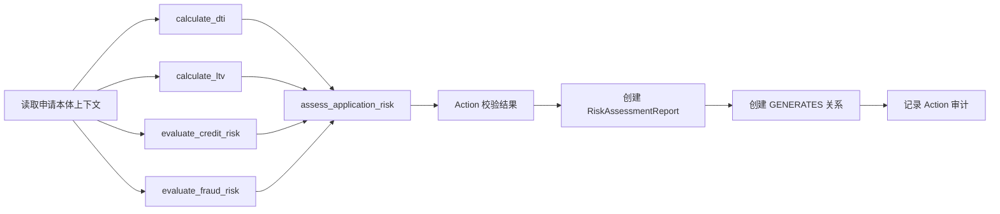

# 个人信审本体 Action 层说明

运行状态更新：2026-08-25

## 1. 文档目的

本文用于说明个人信审本体中的 Action 层是什么、Action 与 Function 的关系，以及一个完整 Action 在实际运行时应包含哪些内容。

本文以 `generate_risk_assessment`（生成风险评估）为例，覆盖：

- Action 的业务职责；
- 输入、输出、前置条件和副作用；
- Action 对应的 Function；
- Function 的执行依赖关系；
- 权限、幂等、审计和异常控制；
- 当前 MVP 已实现内容与后续建设内容。

---

## 2. Action 层是什么

Action 层是本体的**受控业务执行层**。

本体语义层回答：

> 贷款申请、自然人、征信报告是什么，它们拥有哪些属性和关系？

Function 回答：

> 如何读取、计算或推导信息？

Action 回答：

> 在什么条件下，由谁调用哪些 Function，最终允许对业务状态产生什么改变？

一个完整 Action 由以下内容组成：

```text
业务意图
+ 输入/输出对象
+ 前置规则
+ Function 编排
+ 业务副作用
+ 权限与审计
```

Action 可以产生经过授权的业务副作用，例如：

- 创建风险评估报告；
- 创建人工复核任务；
- 更新电核记录；
- 记录决策建议；
- 建立或更新本体实例关系。

Function 不应产生副作用，只负责读取、计算、推导或生成结构化候选结果。

---

## 3. Action、Function、API 与 MCP 的区别

| 层次 | 示例 | 主要职责 |
|---|---|---|
| Action | `generate_risk_assessment` | 完成“生成风险评估”的完整业务动作 |
| Function | `calculate_dti` | 计算负债收入比 |
| Function | `evaluate_credit_risk` | 生成征信风险信号 |
| API / MCP Tool | 图谱查询、风控模型接口 | Function 底层技术实现 |
| PostgreSQL 操作 | 写入评估报告 | Action 成功后的持久化副作用 |

推荐调用关系：

```text
Action
  → Function
      → 本地代码 / SQL / KG 查询 / MCP Tool / 模型 API / LLM
  → Action 校验 Function 结果
  → Action 受控写入业务数据
```

LLM 可以作为某个 Function 的实现，但不能绕过 Action 直接写入 PostgreSQL、NebulaGraph 或业务系统。

---

## 4. 示例 Action：生成风险评估

### 4.1 Action 声明

当前个人信审本体中的 Action 定义如下：

```json
{
  "name": "generate_risk_assessment",
  "label": "生成风险评估",
  "description": "运行只读风险函数并登记一份风险评估报告。",
  "input_types": [
    "LoanApplication",
    "NaturalPerson",
    "Vehicle",
    "CreditReport",
    "ExternalDebt",
    "AntiFraudReport"
  ],
  "output_types": [
    "RiskAssessmentReport"
  ],
  "invokes_functions": [
    "calculate_dti",
    "calculate_ltv",
    "evaluate_credit_risk",
    "evaluate_fraud_risk",
    "assess_application_risk"
  ],
  "effects": [
    "create RiskAssessmentReport",
    "create GENERATES"
  ],
  "preconditions": [
    "申请、征信、反欺诈及车辆数据满足公理"
  ],
  "external_system": null,
  "idempotency_key": "application_id+assessment_version",
  "audit_required": true,
  "execution_mode": "declaration_only"
}
```

### 4.2 字段说明

| 字段 | 含义 |
|---|---|
| `name` | Action 唯一技术标识 |
| `label` | 业务名称 |
| `description` | Action 的业务含义 |
| `input_types` | Action 允许读取的本体对象类型 |
| `output_types` | Action 成功后产生的本体对象类型 |
| `invokes_functions` | Action 允许调用的 Function 清单 |
| `effects` | Action 最终允许产生的业务副作用 |
| `preconditions` | 执行前必须满足的业务条件 |
| `external_system` | 需要调用的外部业务系统 |
| `idempotency_key` | 防止同一动作重复执行的幂等键 |
| `audit_required` | 是否必须记录审计日志 |
| `execution_mode` | 当前执行模式；`declaration_only` 表示仅声明、不执行 |

### 4.3 Action 业务边界

该 Action 允许：

- 读取当前申请相关的自然人、车辆、征信、负债和反欺诈数据；
- 调用风险计算 Function；
- 创建一份 `RiskAssessmentReport`；
- 建立 `LoanApplication -[GENERATES]-> RiskAssessmentReport` 关系；
- 保存风险因子、模型版本、证据和审计信息。

该 Action 不允许：

- 自动通过贷款申请；
- 自动拒绝贷款申请；
- 修改征信原始数据；
- 修改自然人身份信息；
- 绕过人工审批流程；
- 让 LLM 直接写入业务数据库或图数据库。

---

## 5. Action 对应的安全策略

Action 定义“做什么”，Dynamic Security 定义“谁能做、执行边界是什么”。

```json
{
  "action": "generate_risk_assessment",
  "allowed_roles": [
    "系统适配器",
    "风控专员"
  ],
  "denied_roles": [
    "Agent"
  ],
  "approval_required": false,
  "execution_boundary": "只写评估报告，不得写最终审批结果",
  "sensitive_fields": [
    "monthly_income",
    "credit_report",
    "external_debt"
  ],
  "conditions": [],
  "audit_required": true
}
```

安全含义：

- 系统适配器和风控专员可以发起；
- Agent 不能独立执行该 Action；
- Action 只能生成风险评估报告；
- Action 不能直接完成最终审批；
- 收入、征信和负债属于敏感数据；
- 每次执行必须写入审计记录。

---

## 6. 对应 Function

### 6.1 `calculate_dti`：计算负债收入比

```json
{
  "name": "calculate_dti",
  "label": "计算负债收入比",
  "description": "根据月收入和外部存量负债计算 DTI。",
  "input_types": [
    "NaturalPerson",
    "ExternalDebt"
  ],
  "reads_properties": [
    "NaturalPerson.monthly_income",
    "ExternalDebt.balance"
  ],
  "reads_relations": [
    "OWES"
  ],
  "returns": [
    "dti"
  ],
  "deterministic": true,
  "side_effects": false,
  "implementation_status": "not_bound"
}
```

推荐返回格式：

```json
{
  "function_name": "calculate_dti",
  "status": "success",
  "result": {
    "dti": 0.47,
    "total_monthly_payment": 9400,
    "monthly_income": 20000
  },
  "evidence": [
    "NaturalPerson.monthly_income",
    "ExternalDebt.monthly_payment"
  ],
  "implementation_version": "dti-v1.0.0"
}
```

2026-08-24 已实现 `dti-v1.0.0`：严格按 `sum(monthly_debt_payments) / monthly_income` 计算，使用 Decimal 运算并保留 6 位比率精度。零笔存量月供返回 `0`；收入非正、月供缺失、负数、NaN 或无穷值均受控失败。

> PostgreSQL 已在 1.1.0 非破坏性增加 `ExternalDebt.monthly_payment`。`PostgresDTIDataAdapter` 从同一 `REPEATABLE READ / READ ONLY` 快照读取申请借款人月收入和全部外部负债月供；任一月供缺失时受控失败，明确拒绝用负债余额替代。

### 6.2 `calculate_ltv`：计算贷款价值比

```json
{
  "name": "calculate_ltv",
  "label": "计算贷款价值比",
  "description": "根据贷款本金和车辆价格计算 LTV。",
  "input_types": [
    "LoanApplication",
    "Vehicle"
  ],
  "reads_properties": [
    "LoanApplication.loan_amount",
    "Vehicle.invoice_price",
    "Vehicle.guide_price"
  ],
  "reads_relations": [
    "TARGETS"
  ],
  "returns": [
    "ltv"
  ],
  "deterministic": true,
  "side_effects": false,
  "implementation_status": "not_bound"
}
```

计算方式：

```text
LTV = 贷款本金 ÷ 车辆有效价值
```

`ltv-v1.0.0` 的车辆有效价值规则为：发票价格和指导价格都有效时取较低值；只有一个有效值时使用该值；两者都缺失或非正时受控失败。结果同时返回 `value_source`，保证取值规则可解释。

返回示例：

```json
{
  "function_name": "calculate_ltv",
  "status": "success",
  "result": {
    "ltv": 0.82,
    "loan_amount": 164000,
    "vehicle_value": 200000,
    "value_source": "invoice_price"
  },
  "implementation_version": "ltv-v1.0.0"
}
```

### 6.3 `evaluate_credit_risk`：评估征信风险

```json
{
  "name": "evaluate_credit_risk",
  "label": "评估征信风险",
  "description": "汇总贷款、逾期和查询记录形成征信风险信号。",
  "input_types": [
    "NaturalPerson",
    "CreditReport",
    "ExternalDebt"
  ],
  "reads_properties": [
    "CreditReport.outstanding_loan_count",
    "CreditReport.overdue_3y_count",
    "CreditReport.total_overdue_count",
    "CreditReport.inquiry_count",
    "ExternalDebt.overdue_status"
  ],
  "reads_relations": [
    "HOLDS",
    "OWES"
  ],
  "returns": [
    "credit_risk_signals"
  ],
  "deterministic": true,
  "side_effects": false,
  "implementation_status": "not_bound"
}
```

返回示例：

```json
{
  "function_name": "evaluate_credit_risk",
  "status": "success",
  "result": {
    "credit_risk_signals": [
      {
        "signal_code": "MULTIPLE_OVERDUE",
        "risk_level": "HIGH",
        "description": "近 3 年存在多次逾期",
        "evidence": [
          {
            "entity_id": "CR20260001",
            "property": "overdue_3y_count",
            "value": 4
          }
        ]
      }
    ]
  },
  "implementation_version": "credit-risk-rules-v1.0"
}
```

### 6.4 `evaluate_fraud_risk`：评估欺诈风险

```json
{
  "name": "evaluate_fraud_risk",
  "label": "评估欺诈风险",
  "description": "结合反欺诈报告和同联系方式路径形成欺诈风险信号。",
  "input_types": [
    "LoanApplication",
    "AntiFraudReport",
    "NaturalPerson"
  ],
  "reads_properties": [
    "AntiFraudReport.fraud_score",
    "AntiFraudReport.hit_details"
  ],
  "reads_relations": [
    "HAS_FRAUD_REPORT",
    "SHARES_CONTACT"
  ],
  "returns": [
    "fraud_risk_signals"
  ],
  "deterministic": true,
  "side_effects": false,
  "implementation_status": "not_bound"
}
```

返回示例：

```json
{
  "function_name": "evaluate_fraud_risk",
  "status": "success",
  "result": {
    "fraud_risk_signals": [
      {
        "signal_code": "SHARED_DEVICE_REJECTED_CASE",
        "risk_level": "HIGH",
        "score": 0.88,
        "description": "相同设备关联近期被拒申请",
        "evidence_paths": [
          {
            "source": "person:P001",
            "via": "device:D123",
            "target": "application:APP0098",
            "target_status": "REJECTED"
          }
        ]
      }
    ]
  },
  "query_coverage": {
    "candidate_count": 23,
    "evaluated_count": 23,
    "truncated": false
  },
  "implementation_version": "fraud-risk-v1.0"
}
```

如果关联查询发生截断，Function 必须明确返回 `truncated=true`，不得把部分查询结果表述成“未发现其他风险”。

### 6.5 `assess_application_risk`：综合风险评估

```json
{
  "name": "assess_application_risk",
  "label": "综合风险评估",
  "description": "聚合 DTI、LTV、征信与欺诈信号，输出 PD、风险等级和风险因子。",
  "input_types": [
    "LoanApplication",
    "NaturalPerson",
    "Vehicle",
    "CreditReport",
    "ExternalDebt",
    "AntiFraudReport"
  ],
  "reads_properties": [],
  "reads_relations": [
    "SUBMITS",
    "TARGETS",
    "HOLDS",
    "OWES",
    "HAS_FRAUD_REPORT"
  ],
  "returns": [
    "pd_value",
    "risk_level",
    "risk_factors",
    "check_result"
  ],
  "deterministic": false,
  "side_effects": false,
  "implementation_status": "not_bound"
}
```

输入示例：

```json
{
  "application_id": "APP202608210001",
  "dti_result": {
    "dti": 0.47
  },
  "ltv_result": {
    "ltv": 0.82
  },
  "credit_risk_result": {
    "credit_risk_signals": []
  },
  "fraud_risk_result": {
    "fraud_risk_signals": []
  }
}
```

返回示例：

```json
{
  "function_name": "assess_application_risk",
  "status": "success",
  "result": {
    "pd_value": 0.126,
    "risk_level": "HIGH",
    "check_result": "MANUAL_REVIEW",
    "risk_factors": [
      {
        "factor": "DTI_HIGH",
        "value": 0.47,
        "contribution": 0.31,
        "evidence_source": "calculate_dti"
      },
      {
        "factor": "LTV_HIGH",
        "value": 0.82,
        "contribution": 0.24,
        "evidence_source": "calculate_ltv"
      }
    ]
  },
  "model": {
    "name": "personal-credit-risk-model",
    "version": "1.0.0"
  },
  "confidence": 0.89
}
```

该 Function 是非确定性的，正式运行时必须保存：

- 模型名称和版本；
- 特征版本；
- 规则版本；
- 本体版本；
- 输入数据快照时间；
- 置信度；
- 前序 Function 原始结果。

---

## 7. Function 调用依赖

虽然当前 `invokes_functions` 是一个列表，但实际执行应按照有向无环图（DAG）编排：



执行规则：

1. `calculate_dti`、`calculate_ltv`、`evaluate_credit_risk`、`evaluate_fraud_risk` 相互独立，可以并行执行；
2. `assess_application_risk` 必须等待前四个 Function 完成；
3. 任一必需 Function 失败时，Action 不得写入正式评估报告；
4. 可降级的 Function 必须在 Action 契约中明确降级策略；
5. Action 必须验证所有 Function 返回结构、证据、版本和完整性。

---

## 8. Action 执行请求

建议提供如下执行接口：

```http
POST /api/actions/generate_risk_assessment/execute
Content-Type: application/json
```

请求体：

```json
{
  "application_id": "APP202608210001",
  "assessment_version": "v1",
  "requested_by": {
    "user_id": "U1001",
    "role": "风控专员"
  },
  "reason": "电核前风险预评估"
}
```

前端不应传入收入、征信和负债等完整业务数据。Action 应根据 `application_id` 从受控数据源加载数据，防止调用方伪造输入。

---

## 9. Action 执行过程

### 9.1 定位 Action 定义

读取当前本体版本中的：

```text
generate_risk_assessment
```

如果 Action 不存在或未发布，拒绝执行。

### 9.2 权限检查

确认发起人角色属于：

```json
[
  "系统适配器",
  "风控专员"
]
```

未授权时返回：

```json
{
  "status": "REJECTED",
  "error_code": "ACTION_ROLE_DENIED"
}
```

### 9.3 幂等检查

根据以下内容生成幂等键：

```text
application_id + assessment_version
```

例如：

```text
APP202608210001+v1
```

同一幂等键已经成功执行时，返回原执行结果，不重复创建评估报告。

### 9.4 加载本体上下文

根据申请编号加载：

- `LoanApplication`；
- `NaturalPerson`；
- `Vehicle`；
- `CreditReport`；
- `ExternalDebt`；
- `AntiFraudReport`。

只允许读取 Action 和 Function 声明所需的属性及关系。

### 9.5 执行公理和前置条件

至少检查：

- 申请必须关联借款人；
- 申请必须关联车辆；
- 征信报告必须属于当前自然人；
- 应使用最新有效征信报告；
- 车辆价格必须大于零；
- 收入和负债单位必须一致；
- 反欺诈报告必须属于当前申请；
- 相关数据未超过有效期。

### 9.6 调用 Function

依次或并行执行：

```text
calculate_dti
calculate_ltv
evaluate_credit_risk
evaluate_fraud_risk
assess_application_risk
```

### 9.7 校验 Function 输出

Action 必须校验：

- JSON Schema 是否正确；
- 是否出现 `NaN`、空值或非法枚举；
- 数据来源是否齐全；
- Function 和模型版本是否齐全；
- 风险结论是否携带证据；
- 查询是否完整或发生截断；
- 是否读取了未经授权的字段；
- 风险等级与强制规则是否冲突。

### 9.8 产生业务副作用

Action 仅允许：

```text
创建 RiskAssessmentReport
创建 LoanApplication -[GENERATES]-> RiskAssessmentReport
```

### 9.9 记录审计

执行成功、失败、拒绝和重试均必须写入审计记录。

---

## 10. Action 执行审计示例

```json
{
  "execution_id": "ACT202608210001",
  "action_name": "generate_risk_assessment",
  "ontology_version": "1.0.0",
  "application_id": "APP202608210001",
  "idempotency_key": "APP202608210001+v1",
  "requested_by": "U1001",
  "requested_role": "风控专员",
  "status": "SUCCEEDED",
  "invoked_functions": [
    {
      "name": "calculate_dti",
      "version": "1.0.0",
      "duration_ms": 12
    },
    {
      "name": "calculate_ltv",
      "version": "1.0.0",
      "duration_ms": 8
    },
    {
      "name": "evaluate_credit_risk",
      "version": "1.2.0",
      "duration_ms": 36
    },
    {
      "name": "evaluate_fraud_risk",
      "version": "1.1.0",
      "duration_ms": 185
    },
    {
      "name": "assess_application_risk",
      "version": "1.0.0",
      "duration_ms": 328
    }
  ],
  "created_entity": "assessment:RA202608210001",
  "started_at": "2026-08-21T10:01:00+08:00",
  "finished_at": "2026-08-21T10:01:01+08:00"
}
```

---

## 11. Action 最终响应示例

```json
{
  "execution_id": "ACT202608210001",
  "action": "generate_risk_assessment",
  "status": "SUCCEEDED",
  "application_id": "APP202608210001",
  "assessment": {
    "assessment_id": "RA202608210001",
    "risk_level": "HIGH",
    "pd_value": 0.126,
    "check_result": "MANUAL_REVIEW",
    "risk_factors": [
      "DTI_HIGH",
      "LTV_HIGH"
    ]
  },
  "graph_changes": [
    {
      "operation": "CREATE_VERTEX",
      "entity": "RiskAssessmentReport",
      "id": "RA202608210001"
    },
    {
      "operation": "CREATE_EDGE",
      "relation": "GENERATES",
      "source": "APP202608210001",
      "target": "RA202608210001"
    }
  ],
  "next_allowed_actions": [
    "create_phone_verification_task",
    "trigger_manual_review",
    "record_decision_recommendation"
  ]
}
```

---

## 12. 推荐的执行状态机

```text
CREATED
  → VALIDATING
  → RUNNING_FUNCTIONS
  → VALIDATING_OUTPUT
  → COMMITTING
  → SUCCEEDED
```

异常状态：

```text
REJECTED
FAILED
PARTIALLY_FAILED
TIMED_OUT
ROLLED_BACK
```

如果 Action 需要人工审批，可以增加：

```text
WAITING_APPROVAL
APPROVED
REJECTED_BY_APPROVER
```

---

## 13. 推荐的 Function 统一返回信封

所有 Function 建议采用统一结构：

```json
{
  "function_name": "evaluate_credit_risk",
  "status": "success",
  "result": {},
  "evidence": [],
  "confidence": 0.91,
  "implementation_version": "1.2.0",
  "data_snapshot_time": "2026-08-21T10:00:00+08:00",
  "complete": true,
  "warnings": [],
  "duration_ms": 328
}
```

其中：

- `result`：结构化业务结果；
- `evidence`：结果对应的事实、规则或图路径；
- `confidence`：模型或抽取类 Function 的置信度；
- `implementation_version`：代码、规则或模型版本；
- `complete`：本次查询或计算是否完整；
- `warnings`：截断、降级、数据缺失等警告；
- `duration_ms`：执行耗时。

2026-08-24 已由 `backend/app/action/function_registry.py` 落地该统一信封。注册中心会校验本体声明的返回字段、置信度、完整性、证据、警告、实现版本和数据快照时间，并隔离输入、包装下游异常。默认注册中心仍全部未绑定；可选比率注册中心只绑定 DTI/LTV，可选完整只读注册中心显式绑定全部 9 个实现。

---

## 14. 当前 MVP 实现边界

### 14.1 已实现

- ActionType 数据结构；
- 8 个个人信审 Action 声明；
- 9 个 Function 声明；
- Action 与 Function 的 `invokes_functions` 关联；
- Action 输入、输出、前置条件和副作用声明；
- Dynamic Security 权限声明；
- 幂等键声明；
- 审计要求；
- Action 作为 TBox 内容发布到 NebulaGraph；
- 只读 Function 注册中心：加载 9 个本体契约，默认全部未绑定；
- 显式 `bind`、`replace`、`unbind`，不自动加载或启用实现；
- Function 输入隔离、统一返回信封校验和受控异常包装；
- `calculate_dti` 的 `dti-v1.0.0` 确定性实现与显式绑定；
- `calculate_ltv` 的 `ltv-v1.0.0` 确定性实现与显式绑定；
- PostgreSQL `ExternalDebt.monthly_payment` 字段、非负约束和可重复迁移；
- `PostgresDTIDataAdapter` 单快照只读加载、缺失值门禁及 DTI 标准信封执行；
- 剩余 7 个 Function 的版本化只读规则实现；
- 显式绑定全部 9 个实现的 `build_personal_credit_readonly_registry()`；
- `PersonalCreditFunctionDataAdapter` 的 PostgreSQL 单快照加载、NebulaGraph 关联查询和全链统一执行；
- 关联查询截断传播、跨库非原子标记、自然人节点引用脱敏和上游不完整失败关闭；
- 8 个 Action 的机器可读运行设计目录；
- 统一 Action 状态机、步骤 DAG、请求/响应、幂等、审计、错误码、重试与补偿设计，详见 `PERSONAL_CREDIT_ACTION_DESIGN.md`；
- Action 请求业务摘要与基于声明字段的幂等哈希，不保存原始敏感请求；
- 带乐观锁版本号的状态机流转服务；
- PostgreSQL `action_executions` 执行记录表与 `action_audit_events` 追加式审计表；
- 审计 SHA-256 前序哈希链，以及禁止更新/删除审计事件的数据库触发器；
- `POST /api/actions/generate-risk-assessment/execute` 受保护执行入口；
- `POST /api/actions/create-loan-application/execute` 受保护进件入口；
- `POST /api/actions/request-credit-report/execute` 受保护征信查询入口；
- `POST /api/actions/request-fraud-report/execute` 受保护反欺诈查询入口；
- `POST /api/actions/create-phone-verification-task/execute` 受保护电核任务创建入口；
- `POST /api/actions/record-phone-verification/execute` 受保护电核终态回传入口；
- `POST /api/actions/trigger-manual-review/execute` 受保护人工复核路由入口；
- `POST /api/actions/record-decision-recommendation/execute` 受保护决策建议记录入口；
- 自然人、车辆、可选经销商和申请单事务写入、既有主数据兼容复用及公理前置校验；
- 服务端执行身份、业务幂等、风险评估5 Function及反欺诈关联风险 Function 的严格编排与输出门禁；
- 征信、反欺诈、风险报告创建或预创建空报告回填、NebulaGraph 全量 ABox 同步与映射回读；
- 图同步失败时的 PostgreSQL 精确恢复、补偿后图重同步及补偿终态；
- PostgreSQL 持久化 outbox、事件幂等键、数据库租约、指数退避、过期租约接管和服务重启恢复；
- 电核触发信号门禁、严格单 Function 问题生成、任务/关系原子写入、稳定投递编号、成功收据缓存和投递死信保留；
- 电核任务分配校验、回调摘要收据、终态单写、结果图同步和事实保留；
- 来源 Action 审计链、转人工规则、双 Function 证据、状态/原因原子写入和精确补偿；
- 决策建议双 Function、本人确认门禁、Agent 禁止确认、高风险禁止通过、证据血缘和精确补偿；
- `GET /api/actions/executions/{execution_id}` 执行与审计链查询入口；
- 八类 outbox 死信/过期租约告警、服务端运维身份、逐事件人工重放、请求幂等和重放历史；
- 前端“运行监控”页面的状态摘要、告警详情、重放确认和历史查询。
- 征信、反欺诈、电核和 LLM 外部边界的持久化熔断、半开探测、告警去重、三级升级及可选 HTTPS Webhook。
- 申请级持久化流程编排：按依赖组织 8 个 Action，征信/反欺诈并行，人工复核条件跳过，Action/Outbox 自动对账，派发租约恢复和流程哈希审计。

### 14.2 尚未实现

- 正式指标平台、企业通知回执、动态 SLA、值班表和生产外部系统专用 handler；
- 人工审批任务；
- 生产征信、反欺诈和电核系统适配器；三类外部边界均已有中立接口及显式本地沙箱，但默认关闭；
- 风险报告版本化/失效机制；当前公理仍要求每笔申请最多一份有效风险报告。

因此当前 Action 层的准确状态是：

> 8 个 Action 已全部形成具备权限、幂等、可靠 outbox 和防篡改审计的端到端样板。决策建议 Action 具备人工确认门禁且固定为 `recommendation_only`；征信、反欺诈和电核外部适配器默认失败关闭，所有 Action 均不执行最终审批。

8 个 Action 现已通过 `personal-credit-workflow-v1` 形成申请级人工驱动编排。编排只决定依赖和就绪状态，Action 仍独立执行权限、幂等、业务门禁与补偿。

---

## 15. 下一步落地建议

`generate_risk_assessment` 已按下列链路打通为第一个端到端 Action 样板：

```text
权限校验
→ 数据加载
→ 本体公理校验
→ Function 编排
→ 输出和证据校验
→ 创建风险评估报告
→ 增量写入 ABox
→ 记录审计
```

具体建设顺序：

1. **已完成**：建立 Function 注册中心；
2. **已完成**：实现并绑定 `calculate_dti` 和 `calculate_ltv` 两个确定性 Function；
3. **已完成**：一次性完成 8 个 Action 的运行合同和状态机设计；
4. **已完成**：建立 Action 执行记录、幂等、审计持久化和状态机执行器；
5. **已完成**：实现 DTI 月供字段迁移和 PostgreSQL 一致性快照适配；
6. **已完成**：实现剩余 7 个只读 Function、全链数据适配和统一只读执行；
7. **已完成**：打通 `generate_risk_assessment` 的 DAG 编排、受控报告写入、图同步与补偿；
8. **已完成**：建立风险评估图同步的可靠 outbox、租约重试、重启恢复和死信补偿；
9. **已完成**：实现 `create_loan_application` 受控进件、主数据兼容复用、事务 outbox、图同步与受限补偿；
10. **已完成 MVP 运行骨架**：实现 `request_credit_report` 授权与主体校验、供应商中立接口、稳定请求号、受保护响应收据、报告/HOLDS、事务 outbox 和精确补偿；真实供应商合同仍未接入；
11. **已完成 MVP 运行骨架**：实现 `request_fraud_report` 核心关系门禁、关联风险 Function、供应商幂等收据、报告/HAS_FRAUD_REPORT、事务 outbox 和精确补偿；真实供应商合同仍未接入；
12. **已完成 MVP 运行骨架**：实现 `create_phone_verification_task` 风险触发校验、问题生成、任务/HAS_PHONE_VERIFICATION、幂等投递和死信保留；真实电核系统仍未接入；
13. **已完成 MVP 运行骨架**：实现 `record_phone_verification` 的服务端分配校验、回调摘要收据、终态幂等写入、图同步和事实保留；
14. **已完成 MVP 运行骨架**：实现 `trigger_manual_review` 的来源审计、规则、双 Function 证据、转人工路由和精确补偿；
15. **已完成 MVP 运行骨架**：实现 `record_decision_recommendation` 的双 Function 证据、本人确认门禁、建议/血缘事务写入、图同步和精确补偿；
16. **已完成 MVP 运行骨架**：实现八类 outbox 死信告警、服务端身份、逐事件人工重放、历史终态保留、幂等请求和前端处理入口；
17. 在真实供应商合同和计费/投递幂等策略就绪后实现生产征信、反欺诈及电核适配器；
18. **已完成 MVP 运行骨架**：实现外部调用持久化熔断、告警去重、后台升级、前端红点、确认/解决和可选 HTTPS Webhook；
19. 接入正式指标平台、企业通知回执、动态 SLA 和值班表；
20. 建立包含成功创建、空占位回填、失败补偿、任务保留和并发冲突的 UAT 数据集与评测指标。

通过该样板，可以验证 Action 层最核心的价值：

> 将 LLM、KG、规则、模型和外部系统能力纳入有业务语义、有权限边界、有审计记录、可验证和可回滚的执行流程。
